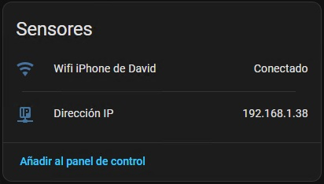
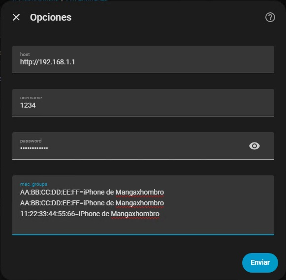
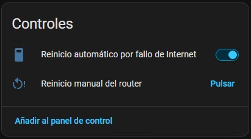
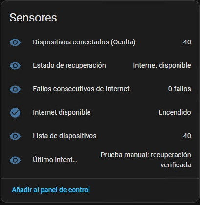
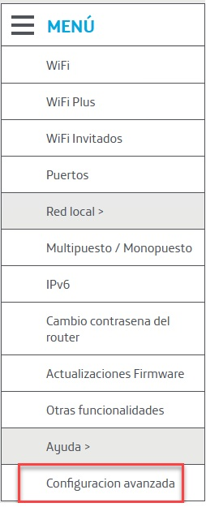
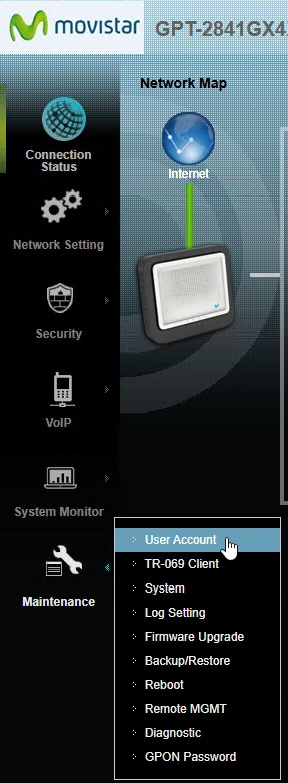

# MitraStar GPT-2841GX4X5 — Custom Integration for Home Assistant

[🇪🇸 Leer en español](README_es.md)

> **Disclaimer:** This community integration is intended for use with MitraStar GPT-2841GX4X5 routers deployed on Movistar networks. It is an independent, unofficial project with no affiliation with, sponsorship by, or endorsement from Telefónica/Movistar or MitraStar. Brand and model names are used solely to identify the intended compatibility.

This integration connects Home Assistant to the MitraStar GPT-2841GX4X5 router (Movistar Smart WiFi 6 Router) and provides two main features:

- **Connected device tracking:** Registers all devices connected to the router in Home Assistant as binary sensors. Each device is shown as connected or disconnected, and its IP address is also provided. This allows you to build a robust and responsive presence detection system based on whether mobile devices are connected to your Wi-Fi networks.
- **Internet connectivity monitoring:** If the Internet connection is lost, the integration performs three consecutive checks, spaced 60 seconds apart. If all three checks fail, the integration can issue a controlled software reboot of the router, provided automatic reboot is enabled. A button is also available to reboot the router manually.

## Binary sensor management

The integration exposes the connection status of devices (connected/disconnected) as binary sensors and provides their IP addresses.

This allows you to create informational dashboards in Home Assistant or build automations that use device connection status as a presence sensor. For example, with Apple mobile devices, this can be a more robust, reliable, and responsive solution than relying solely on the Home Assistant Companion app integration on those devices.

### Grouping multiple MAC addresses as a single device

Device tracking is based on MAC addresses. Some devices use different MAC addresses when connecting to different home Wi-Fi networks. The integration can group multiple MAC addresses under a single logical device, providing more reliable detection and avoiding duplicate devices. When this feature is used, the integration automatically groups the matching devices into a single entity.

In Home Assistant, go to **Settings → Devices & services → MitraStar Router → Configure** (options).

In the **MAC address associations** field, add one line for each MAC address, using the following format:

`AA:BB:CC:DD:EE:FF=iPhone of Mangaxhombro`

Multiple MAC addresses can be associated with the same name, one per line:

`AA:BB:CC:DD:EE:FF=iPhone of Mangaxhombro`

`11:22:33:44:55:66=iPhone of Mangaxhombro`

Grouped MAC addresses are represented by a single logical presence entity. The **Connected devices** sensor counts each group only once, while **Device list** retains the router's physical inventory, including individual MAC addresses.

## Internet connectivity monitoring

### Automatic management

- Checks TCP port 53 on `1.1.1.1` and `8.8.8.8` every 60 seconds. A connectivity failure is registered only if both destinations fail.
- Failure threshold: 3 consecutive failed checks.
- Automatic reboot is disabled by default and can be enabled using the Home Assistant switch.
- The reboot mechanism sends a POST request to `/cgi-bin/reboot.cgi` with `restoreFlag=1` and `RestartBtn=RESTART`, reusing the authenticated session.
- Before sending the reboot command, the integration checks that the router's local administration interface is accessible.
- The last reboot attempt and lockout state are stored in persistent Home Assistant storage.
- After a reboot is attempted, the integration will not repeat it during the same failure episode. Five minutes of stable Internet connectivity are required before another episode can trigger a reboot.
- The integration waits up to 10 minutes for local administration and Internet connectivity to recover. If recovery fails, it remains locked out and records the error.

### Manual router reboot

The **Manual router reboot** button allows you to explicitly request a reboot without enabling the automatic reboot switch. When pressed, the integration first checks that the router's administration interface is responding, sends the HTTP reboot request used by the watchdog, and then checks for up to 10 minutes that local administration and Internet connectivity have returned. The outcome is reflected in the recovery status and the last-attempt sensor.

**Warning:** Pressing this button will actually reboot the router, temporarily interrupting the connection. This test alone does not prove that the router firmware will interpret the HTTP parameters as expected. Keep automatic reboot disabled until the reboot procedure has been tested successfully.

## Sensor dashboard

## Installation via HACS

1. Open **HACS → Integrations** in Home Assistant.
2. Open the three-dot menu and select **Custom repositories**.
3. Add `https://github.com/Mangaxhombro/ha-mitrastar-gpt-2841gx4x5` as a repository with the category **Integration**.
4. Search for **MitraStar GPT-2841GX4X5** and install it.
5. Restart Home Assistant.
6. Go to **Settings → Devices & services → Add integration** and search for **MitraStar GPT-2841GX4X5**.
7. Follow the configuration wizard.

Installing this integration as a custom repository does not mean that it is included in the default HACS catalogue.

## Manual installation

Copy the `mitrastar_router` folder to `/config/custom_components/mitrastar_router/`, restart Home Assistant, and reload the integration. Back up the existing folder, if present, before replacing it.

## Configuration

During the initial setup, the integration asks for the router's local IP address, username, and password.

The username can be found in the router's advanced configuration interface under **Maintenance → User Account**.

The password is the one configured for accessing the router's administration interface.

## Limitations

The remote reboot function requires a controlled test on the specific router firmware. Keep the automatic reboot switch disabled until you have verified connectivity monitoring, and enable it only if you accept that the router may reboot when both external destinations fail for three consecutive checks. TCP connectivity checks may fail if the network blocks TCP port 53; they do not rely on ICMP ping.

Due to a router limitation that prevents multiple user sessions from being managed independently, accessing the router's administration interface manually while the integration is enabled may cause the web administration session to be logged out when the integration next connects automatically.

It is therefore recommended to temporarily disable the integration whenever you need to make changes through the router's web administration interface.

If you’ve found this integration useful, I’d really appreciate your support and contribution:

