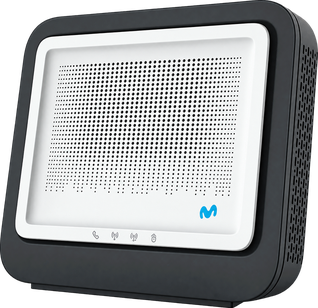

# MitraStar GPT-2841GX4X5 — integración personalizada para Home Assistant

[🇬🇧 Read in English](README.md)

> **Aviso de independencia:** Esta integración comunitaria está destinada a funcionar con routers MitraStar GPT-2841GX4X5 utilizados en redes Movistar. Es un proyecto independiente y no oficial, sin afiliación, patrocinio ni respaldo de Telefónica/Movistar ni de MitraStar. Los nombres de marcas y modelos se utilizan únicamente para identificar la compatibilidad prevista.

Esta integración permite conectar Home Assistant con el router MitraStar GPT-2841GX4X5 (Router Smart WiFi 6 de Movistar) 

## Pre-requisitos

Tener el router Mitrastar modelo: GPT-2841GX4X5 con el firmware: GL_g2.11_100XNQ0b21. (Es posible que la interación funcione en otros modelos de router, y más probable aun con otras versiones de firmware del mismo royter, pero como no tengo otros routers no he podido probarlo.

Para comprobar el modelo hay que entrar en la web de administración del router --> configuración avanzada. En la parte superior aparece el modelo:

para realizar dos funciones:

- Dar de alta en Home Assistant, como sensores binarios, todos los dispositivos conectados al router. Muestra los dispositivos como conectado o no y adicionalmente muestra la dirección IP de cada uno de ellos. Esto permite, entre otras cosas, gestionar un robusto y ágil sistema de control de presencia asociado a la conexión a las redes Wifi de los dispositivos móviles.
- Monitorización de la conexión a internet y automatización del reinicio del router en caso de problemas de conexión. ¡¡Olvídate de quedarte sin conexión en tu instalación domótica de casa por un problema de conexión o del router!! Esta situación, cuando no estás en casa, puede ser un verdadero incordio sobre todo si estas de vacaciones. En caso de que la instalación pierda la conexión a internet, después de realizar tres comprobaciones (con una separación de 60 segundos entre cada una de ellas), detectando tres fallos consecutivos, la integración lanza un reinicio controlado por software del router. Además también dispone de un botón para poder realizar un reinicio manual.

## Gestión de sensores binarios

La integración muestra el estado binario de los dispositivos (conectado/desconectado) así como la dirección IP.

Esto permite mostrar en HA paneles informativos en relación a los dispositivos o crear automatizaciones que utilicen dicho estado a modo de sensor de presencia. Lo cual en caso por ejemplo de dispositivos móviles de Apple, es un sistema mucho más robusto, fiable y rápido que la propia integración de la propia app de HA en dichos dispositivos. 

### Agrupar varias MAC como un único dispositivo

La gestión de dispositivos se hace mediante la dirección MAC. En el caso de algunos dispositivos, al conectarse a las diferentes redes Wifi domésticas, la dirección MAC cambia. La integración dispone de una funcionalidad de agrupación de un mismo dispositivo bajo diferentes direcciones MAC. Esto garantiza una detección mucho más fiable y libre de errores o dispositivos repetidos. Cuando se utiliza esta funcionalidad la integración elimina automáticamente los dispositivos repetidos dejando un único dispositivo.

En Home Assistant, abre **Ajustes → Dispositivos y servicios → Mitrastar Router → Configurar** (opciones).
En el campo **Asociaciones de MAC**, añade una línea por cada dirección MAC, con el formato:

`AA:BB:CC:DD:EE:FF=iPhone de Mangaxhombro`

Se pueden asociar varias MAC al mismo nombre, una por línea:

`AA:BB:CC:DD:EE:FF=iPhone de Mangaxhombro`

`11:22:33:44:55:66=iPhone de Mangaxhombro`

Las MAC agrupadas se muestran como una única entidad lógica de presencia. El sensor **Dispositivos conectados** cuenta cada grupo una sola vez; **Lista de dispositivos** conserva el inventario físico del router, incluidas las MAC individuales.

## Monitorización de la conexión a internet

### Gestión automática

- Comprueba TCP/53 contra 1.1.1.1 y 8.8.8.8 cada 60 segundos; declara fallo solo si fallan ambos.
- Umbral: 3 fallos consecutivos.
- El reinicio automático está desactivado por defecto; se habilita con el interruptor de Home Assistant.
- El mecanismo usa POST `/cgi-bin/reboot.cgi` con `restoreFlag=1` y `RestartBtn=RESTART`, reutilizando la sesión autenticada.
- Antes de enviar la orden, comprueba el acceso local al router.
- Guarda el último intento y el bloqueo en almacenamiento persistente de Home Assistant.
- Si se intenta un reinicio, no repite durante el mismo episodio; exige 5 minutos de Internet estable para desbloquear un nuevo episodio.
- Espera hasta 10 minutos para verificar administración local e Internet. Si no se recupera, queda bloqueado y registra el error.

### Reinicio manual del router

La entidad de botón **Reinicio manual del router** permite solicitar un reinicio explícito sin activar el interruptor de reinicio automático. Al pulsarla, la integración comprueba primero que la administración del router responde, envía la petición HTTP de reinicio usada por el watchdog y verifica durante un máximo de 10 minutos que vuelven la administración local y la conectividad a Internet. El resultado se refleja en el estado de recuperación y en el sensor de último intento.

**Advertencia:** al pulsar este botón el router se reinicia realmente y la conexión se interrumpe temporalmente. La prueba no demuestra por sí sola que el firmware no interprete de forma diferente los parámetros HTTP. Mantén desactivado el reinicio automático hasta completar la prueba.

## Panel de sensores

## Instalación mediante HACS

1. Abre **HACS → Integraciones** en Home Assistant.
2. Abre el menú de los tres puntos y selecciona **Repositorios personalizados**.
3. Añade `https://github.com/Mangaxhombro/ha-mitrastar-gpt-2841gx4x5` como repositorio de categoría **Integración**.
4. Busca **MitraStar GPT-2841GX4X5** e instálala.
5. Reinicia Home Assistant.
6. Ve a **Ajustes → Dispositivos y servicios → Añadir integración** y busca **MitraStar GPT-2841GX4X5**.
7. Sigue el asistente de configuración.

La instalación mediante repositorio personalizado no implica que esta integración esté incluida en el catálogo predeterminado de HACS.

## Instalación manual

Copia la carpeta `mitrastar_router` a `/config/custom_components/mitrastar_router/`, reinicia Home Assistant y recarga la integración. Haz copia de seguridad de la carpeta anterior (si la hubiera) antes de sustituirla.

## Configuración

Tras la primera instalación, la integración pedirá la IP local del router, el nombre de usuario y la contraseña.

El nombre de usuario se obtiene desde la zona de configuración avanzada --> Mantenimineto --> Cuenta de usuario.

La contraseña es la que hayamos puesto para el acceso a la configuración del router.

## Limitaciones

El reinicio remoto requiere una prueba controlada en el firmware concreto. Mantén el interruptor apagado hasta verificar la monitorización y habilítalo solo cuando aceptes que puede reiniciar el router si ambos destinos externos fallan durante tres ciclos. La comprobación TCP puede fallar si la red bloquea TCP/53; no se basa en ping ICMP.
Debido a limitaciones del router, que no puede gestionar varias cuentas de usuario, si se trata de acceder a la configuración del router con la integración habilitada, se desconectará la sesión manual abierta en la web de configuración del router en la siguiente conexión automática de la integración al router. Recomiendo deshabilitar temporalmemte la integración cuando se tenga que realizar alguna configuración desde la web de administración del router.

Si esta integración te ha resultado útil te agradecería mucho tu apoyo y contribución:

